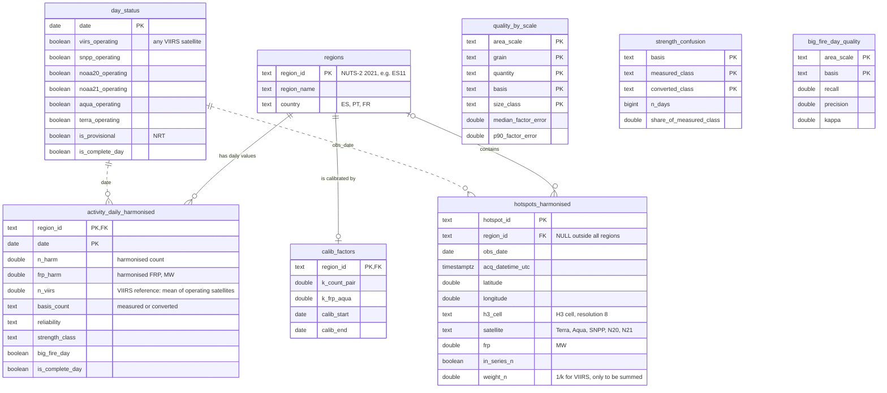
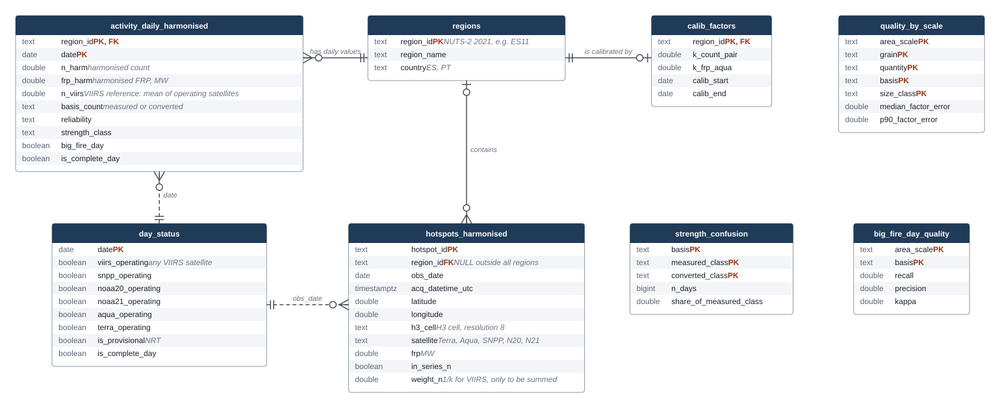

# Data model

Database schema of La-Brasa, defined in [`../init/001_schema.sql`](../init/001_schema.sql).
Every table except `regions` is a 1:1 copy of a harmonised Parquet file in `data/harmonised/`,
loaded by `pipeline/load_to_db.py`. What each column means (units, "empty vs. 0") is documented in
[`harmonisation/docs/data_dictionary.md`](../../harmonisation/docs/data_dictionary.md).

**Schema version 2** (14.11.2026): the VIIRS reference is the mean of the operating VIIRS satellites SNPP, NOAA-20 and
NOAA-21 (`n_viirs`, `frp_viirs`, `viirs_operating`); raw values per satellite stay available; hotspots carry an H3 cell
(`h3_cell`, resolution 8). Why: [`harmonisation/docs/viirs_extension.md`](../../harmonisation/docs/viirs_extension.md).
`pipeline/load_to_db.py` checks `schema_version` in `data/harmonised/manifest.json` against its `SCHEMA_VERSION`.

| Table | Change in version 2 |
|---|---|
| `activity_daily_harmonised` | new `n_noaa20`, `n_noaa21`, `n_viirs`, `frp_noaa20`, `frp_noaa21`, `frp_viirs`; `n_snpp`/`frp_snpp` are now raw values only |
| `day_status` | new `viirs_operating` (the day is measured), `noaa20_operating`, `noaa21_operating` |
| `hotspots_harmonised` | new `h3_cell`; `satellite` also `N20`, `N21`; `weight_n` = 1/k for VIIRS |
| all others | unchanged |

## Entity relationship model

Solid lines are foreign keys enforced by the database. Dashed lines are logical relationships:
the tables match on a value (a date), but the database does not enforce it.
The diagram shows keys and the most important attributes; the full column list is in the
[relational model](#relational-model).



The same diagram as an image: [`er_diagram.svg`](er_diagram.svg).



### Relationships

| From | To | Cardinality | Via | Enforced |
|---|---|---|---|---|
| `regions` | `activity_daily_harmonised` | 1 : 0..n | `region_id` | yes (FK) |
| `regions` | `hotspots_harmonised` | 0..1 : 0..n | `region_id` (NULL for hotspots outside every region) | yes (FK) |
| `regions` | `calib_factors` | 1 : 0..1 | `region_id` (primary key of both) | yes (FK) |
| `day_status` | `activity_daily_harmonised` | 1 : 0..n | `date` | no, logical |
| `day_status` | `hotspots_harmonised` | 1 : 0..n | `obs_date` = `day_status.date` | no, logical |

`quality_by_scale`, `strength_confusion` and `big_fire_day_quality` are lookup tables of the error model.
They have no foreign keys: the backend looks values up by area scale, time step and basis.

## Relational model

Notation: **bold** = primary key, ↗ `table` = foreign key to that table.

**regions** (**region_id**, region_name, country)

**activity_daily_harmonised** (**region_id** ↗ `regions`, **date**, country, region_name,
n_aqua, n_terra, n_snpp, n_noaa20, n_noaa21, n_viirs, frp_aqua, frp_terra, frp_snpp, frp_noaa20, frp_noaa21, frp_viirs,
basis_count, basis_frp,
n_harm, frp_harm, factor_count, factor_frp, strength_class, big_fire_day,
n_harm_lo50, n_harm_hi50, n_harm_lo90, n_harm_hi90,
frp_harm_lo50, frp_harm_hi50, frp_harm_lo90, frp_harm_hi90,
reliability, is_complete_day, possible_gap)

**hotspots_harmonised** (**hotspot_id**, latitude, longitude, cell_id, h3_cell, acq_date, acq_time,
acq_datetime_utc, obs_date, local_solar_hour, satellite, sensor, source, daynight,
frp, frp_class, confidence_class, confidence_raw, scan, track, pixel_area_km2,
region_id ↗ `regions`, country, in_series_n, in_series_frp, weight_n, weight_frp,
basis_count, basis_frp)

**day_status** (**date**, viirs_operating, snpp_operating, noaa20_operating, noaa21_operating, aqua_operating, terra_operating,
basis_count, basis_frp,
is_complete_day, is_provisional, possible_gap)

**calib_factors** (**region_id** ↗ `regions`, k_count_pair, k_count_aqua, k_count_terra,
k_frp_pair, k_frp_aqua, k_frp_terra, used_fallback_pair, used_fallback_aqua, used_fallback_terra,
n_viirs_calib, n_pair_calib, n_aqua_calib, n_terra_calib,
k_count_pair_overall, k_count_aqua_overall, k_count_terra_overall, calib_start, calib_end)

**quality_by_scale** (**area_scale**, **grain**, **quantity**, **basis**, **size_class**, class_upper,
n_units, median_factor_error, p90_factor_error, abs_upper_p50, abs_upper_p90,
coverage50_holdout_low, coverage50_holdout_high, coverage90_holdout_low, coverage90_holdout_high,
factor_shift, n_test)

**strength_confusion** (**basis**, **measured_class**, **converted_class**, n_days, share_of_measured_class)

**big_fire_day_quality** (**area_scale**, **basis**, threshold_measured_mw, threshold_converted_mw,
recall, precision, kappa, n_events_measured, n_events_converted, n_units)

## Design notes

- **Denormalised on purpose.** `activity_daily_harmonised` and `hotspots_harmonised` repeat
  `country` (and the daily table `region_name`) from `regions`. The tables mirror the Parquet files
  1:1, so the loader copies without transforming. `regions` is derived from the daily table, so the
  values cannot disagree.
- **NULL is not 0.** NULL means "no value" (satellite not operating, no data); 0 means "no fire".
- **Full reload.** The loader replaces all tables in one transaction per harmonisation run, so the
  tables always belong to the same run.
- **Not stored:** weeks, months, years and area aggregates. The backend computes them from the daily
  values.

## Updating this document

Change the schema in `../init/001_schema.sql` first, then this file, and raise `SCHEMA_VERSION` in
`pipeline/load_to_db.py` together with `schema_version` in `harmonisation/pipeline_config.yaml`.
`pipeline/tests/test_load_to_db.py` checks that the SQL columns match `harmonisation/docs/data_dictionary.md`.

Regenerate the SVG from the Mermaid block above. Without Node or a browser (standard-library Python, used for version 2):

```bash
python db/docs/build_er_diagram.py      # reads the Mermaid block, writes er_diagram.svg
```

With mermaid-cli (Node and a headless browser):

```bash
cd db/docs
npx -y -p @mermaid-js/mermaid-cli@12.2.0 mmdc -i data_model.md -o er_diagram.md -a . -b white
# writes er_diagram.md plus er_diagram-1.svg: keep the SVG, delete the generated .md
# (white background, so the diagram stays readable in dark mode)
mv er_diagram-1.svg er_diagram.svg && rm er_diagram.md
```
